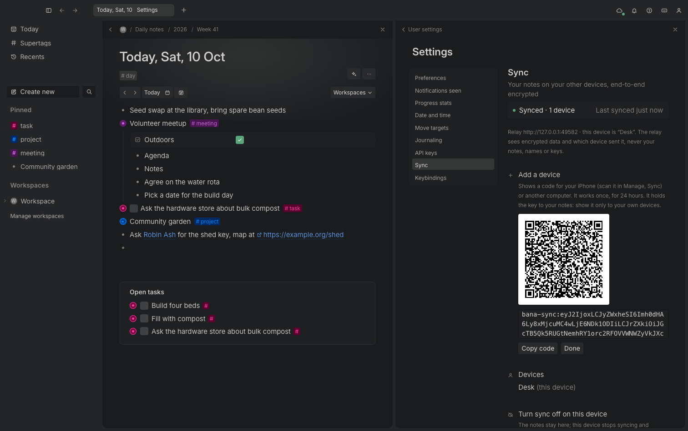
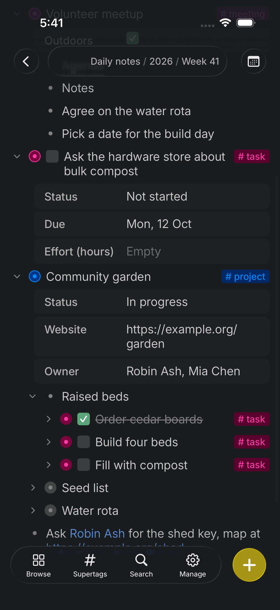
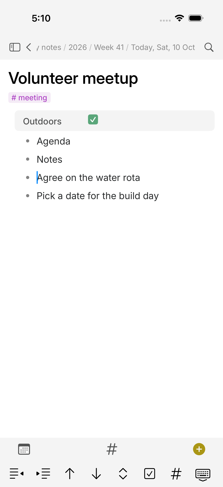
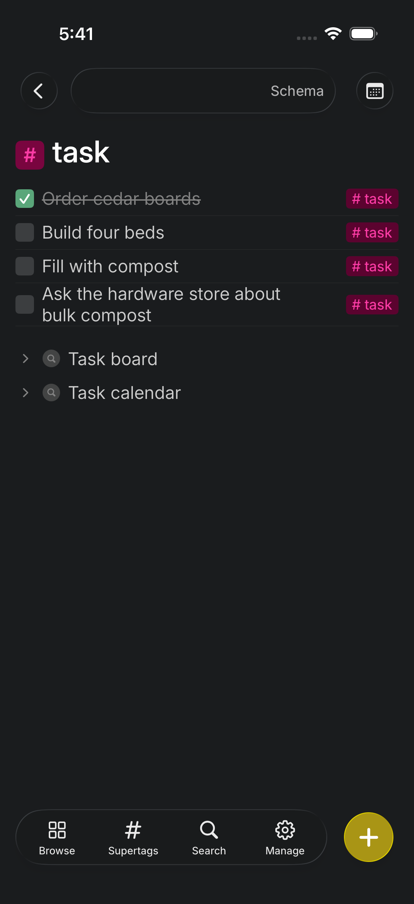

<h1 align="center">Bana</h1>

<p align="center">
  <b>A keyboard-first outliner with supertags, fields and daily notes: a clean-room, open-source
  outliner inspired by the Tana outliner, built in Rust.</b>
</p>

<p align="center">
  Every bullet is a node. Tag a node with a supertag and it gains that supertag's fields. Reference any
  node from anywhere. Write by hierarchy or by day. Your graph is a local file, and every action
  is a command that people, scripts and AI agents can run.
</p>

<p align="center">
  
  <br><sub><b>Today.</b> Daily notes, supertag chips, field rows, references and an Open tasks card.</sub>
</p>

## Tour

<table>
<tr>
<td width="50%" valign="top"><p align="center"><sub><b>Panels.</b> Open any node beside the current one; fields from supertags sit in soft boxes.</sub></p></td>
<td width="50%" valign="top"><p align="center"><sub><b>Calendar.</b> Items on their dates; month, week and day.</sub></p></td>
</tr>
<tr>
<td width="50%" valign="top"><p align="center"><sub><b>Search nodes.</b> Live queries with nested AND, OR and NOT groups; results wait for Run once.</sub></p></td>
<td width="50%" valign="top"><p align="center"><sub><b>Board.</b> Cards grouped by a field; drag a card to change its value.</sub></p></td>
</tr>
<tr>
<td width="50%" valign="top"><p align="center"><sub><b>Table.</b> Cells are typed in place; columns, sort, group and filter from the toolbar.</sub></p></td>
<td width="50%" valign="top"><p align="center"><sub><b>Supertags.</b> Pinned ones as tiles, then every supertag of the workspace.</sub></p></td>
</tr>
<tr>
<td width="50%" valign="top"><p align="center"><sub><b>Command line (Cmd+K).</b> Steps for the line you are on first, then every command.</sub></p></td>
<td width="50%" valign="top"><p align="center"><sub><b>Light theme.</b> Tuned, not inverted: regular text is weight 400 here and 375 in dark.</sub></p></td>
</tr>
</table>

Every screenshot is Bana itself (the web UI, rendered by `cargo xtask shots`). The look follows
the spec team's measured design ([DESIGN.md](DESIGN.md)); icons are our own.

## Why

Tana showed that an outliner gets much more useful when nodes can carry types: tag a bullet `#task`
and it gains a status, a due date and a checkbox; ask a search node for every open task and it stays
live. Bana rebuilds that model as open source:

- **Local and yours.** One JSON file per workspace on your disk, saved atomically. No account, no server.
- **Fast and small.** A Rust engine with a thin web UI (Tauri); it never blocks on the network.
- **Scriptable to the core.** Every action is a command with an id. The keyboard, the command line, the CLI, the MCP server and the JSON API all run the same commands, so an agent can do anything you can.
- **Clean room.** Built from public docs and a black-box behaviour spec; see [Clean room](#clean-room).

## What works today

| Area | Highlights |
|---|---|
| **Outline** | Enter, Shift+Enter, Tab, Shift+Tab, Backspace and Delete as in the spec, wrapped long lines, caret where you click, moves across branches, Escape and Shift+Up/Down selection with a floating toolbar, drag and drop, paste as nodes or references, headings, descriptions edited in place, inline bold/italic/underline/highlight/code that carry on as you type, links, checklists with progress |
| **Supertags** | Inline `#` menu, colours (or none, or custom), extends, base types, template fields and nodes, optional and pinned fields, title expressions, checkbox and done mapping, default child supertag, related content, convert a node to a supertag |
| **Fields** | `>` field rows (Tab to the value, Enter for another value); plain, options, options from a supertag, date (with time ranges), number, URL, email, checkbox; several values per field, option sources and auto-collect, required, hide rules, invalid-value warnings, auto-initialize |
| **Search** | Search nodes with nested AND/OR/NOT groups, field comparisons and field values (parent, relative dates, set, defined), date, type, scope and workspace operators; new results flash; Search and open with fuzzy matching and snippets; a context-aware command line |
| **Views** | Outline, table (full width, rename columns in place, resize), cards, board, lanes (drag between lanes), list (detail in the next panel), side menu, tabs, calendar (month, week and day with a time grid); display, sort, group and filter from an icon toolbar |
| **Daily notes** | Year, week and day nodes, relative titles, Open tasks card, week Schedule, go to date, insert date, dates that link to their day |
| **Shell** | Tabs, resizable panels, sidebar full/mini/hidden with flyouts, pinned items, quick add, capture Inbox, several workspaces side by side (each with its own Library, Schema and Trash), page icons and banners, content width, Help page, settings with sub-pages (date and time, sidebar entries, URL embeds), a native macOS menu bar, trash |
| **Undo** | Every command is one undo step; typing a word is one step; a failed command changes nothing |
| **Files** | One graph file (`~/Bana/graph.bana` by default, a Loro CRDT document so copies edited apart merge; older JSON files are read once and kept as a backup) holding every workspace, atomic autosave, repair of damaged files, Markdown, JSON and OPML export, Markdown and OPML import, HTML plus text on the clipboard |

Status per spec section and screenshot: [docs/parity.md](docs/parity.md) (77 of 95 spec sections
done, 13 partial; 140 of 160 screenshots done). AI features are out of scope for now.

## Data safety

The web UI never owns your notes. Every keystroke goes to the engine at once, in order; a key
pressed while a command is still moving the caret waits and is replayed into the right line. Each
edit and each waiting key is also written to a log in the browser's session storage the moment it
happens, and leaves it only once the engine has it; after a reload the rest is replayed, and the
engine runs each logged edit exactly once. Two windows on one graph each keep their own page and
caret, and when both type in the same line, both windows' words are kept. The engine autosaves within a second and saves on quit.
Playwright fuzz tests type random keys at full speed (also on a long page in a small window,
scrolled away mid-edit), reload the window at a random point with the CPU slowed 4 to 6 times, and
force-kill the engine; not one character may go missing.

The graph file is a [Loro](https://loro.dev) CRDT document: two copies edited apart (two devices,
offline) merge, with concurrent typing in one line, concurrent moves (never a loop), delete versus
edit, and tags and fields added on both sides covered by tests. Undo and redo keep working after a
merge and take back only this copy's edits. History is never cut by age: compaction drops only
what every paired copy has acknowledged (a copy that is not paired, such as a backup, keeps the
whole history), so a copy that was away for any time (a phone offline for months) still merges. Empty parts of a node store nothing, which keeps the file small. Older JSON graph
files are read once and kept as a backup.

## Sync between your Mac and your iPhone

Each device keeps its own full copy and works offline; online, it sends its changes, end-to-end
encrypted, through a small relay you run on your own Cloudflare account (free plan: a Worker and a
Durable Object). Pair the phone by scanning a QR code from **Settings, Sync, Add a device**.
Edits from the other device show up live without moving your caret, typing in one line on both
keeps both, and a phone away for weeks catches up. The relay sees only ciphertext and routing data;
[docs/sync.md](docs/sync.md) says what it can and cannot see. Set it up with
`cloudflare/sync/wizard.sh` (it also shows how to put the iPhone app on your own phone).

<p></p>

## Speed and robustness

Measured on a generated 50,000-node workspace (`sample::large`), release build, Apple Silicon laptop:

| Action | Time |
|---|---|
| Typing one character (engine) | 0.001 ms |
| Enter, expand or collapse, undo (engine) | under 0.01 ms |
| Substring search / fuzzy Search and open over every node | 15 ms / 27 ms |
| Save while typing (Loro document, changes only) / load the graph file | 30 ms / 0.5 s |
| Web UI: 51,550 rows expanded: jump to 60 % and draw / 15 keys to the engine | about 120 ms / 120 ms (debug engine) |

The web outline draws only the rows near the viewport and asks the engine for that window of rows
only. A row never holds unsaved text (every keystroke is already in the engine), and a key typed
while the line being edited is scrolled away brings it back first. Reproduce:
`cargo test -p bana-commands --test perf --release -- --nocapture` and
`pnpm --dir web exec playwright test perf`.

A fuzz test runs random sequences of every command (params built from each command's own
description) and checks after each step that owners and children agree, nothing is orphaned or in a
loop, every change undoes and redoes exactly, and save/load round-trips; damaged files (loops, double
owners, dangling ids, links to nodes of the wrong kind) load into a sound graph and keep working under
random commands; after every few steps the Loro document written so far must hold exactly the same
graph. The web UI's fuzz tests are described under [Data safety](#data-safety). Longer runs:
`FUZZ_SEEDS=1000 FUZZ_STEPS=400 cargo test -p bana-commands --test fuzz --release` and
`FUZZ_SEEDS=40 pnpm --dir web exec playwright test fuzz`. Which of the old egui UI tests have been
ported to the web UI: [docs/web-port.md](docs/web-port.md).

## Quick start

```sh
pnpm --dir web install && pnpm --dir web build             # the web UI (once, and after UI changes)
cargo run --release -p bana-desktop -- --sample       # the desktop app (Tauri) with the sample graph
cargo run --release -p bana-desktop -- notes.json     # open or create a graph file
cargo run --release -p bana-cli -- serve --sample     # the same UI in a browser: http://127.0.0.1:8787/
cd apps/bana-desktop && ../../web/node_modules/.bin/tauri build --bundles app   # Bana.app
```

Then press **Cmd+K** for every command, **Cmd+S** to search and open, **Cmd+E** for quick add and
**Cmd+/** for the shortcut sheet.

Tests: `cargo xtask ci` (Rust: fmt, clippy, 163 tests), `cargo xtask web` (typecheck, build,
Playwright: 121 tests plus 179 use-case scenarios, each against its own engine) and
`cargo xtask connector` (the remote MCP connector). Screenshots: `cargo xtask shots`.

## iPhone app

A native SwiftUI app (`apps/bana-ios`, iOS 26; on your own phone through Xcode, see the sync wizard) on the same
Rust engine: `crates/ffi` exposes it to Swift with UniFFI (open a graph, run any command by id with
JSON params, read the same view snapshots the web UI draws, hear about changes). The graph lives in
the app's Documents folder as `graph.bana`, the same Loro file the desktop app writes.

<p>

</p>

```sh
scripts/build-ios-core.sh                 # engine for device and simulator, Swift bindings, XCFramework
scripts/ios-test.sh                       # generate the Xcode project (xcodegen), run the UI tests
scripts/ios-test.sh shots                 # screenshots of the main screens into docs/images/ios/
scripts/ios-test.sh sync                  # pairs with a desktop engine through a local relay
```

What works: the day page with previous and next day, the outline with bullets, tap to edit, Return
for a new line, Backspace to merge, indent, outdent, move, collapse, checkbox, supertag and undo
on an editing bar, zoom in with breadcrumbs and Back, tags and fields (text, options, checkbox), search,
quick capture, supertag pages, the sidebar as a Home sheet, and sync with the desktop (Manage,
Sync: scan the QR code or paste the code; it syncs on launch, in the foreground and in the
background). Every keystroke goes to the engine;
the file is written within half a second and at once when the app leaves the foreground. The
chrome (top bar, tab bar, editing bar, Capture button, sheets, search) is iOS 26 Liquid Glass
floating over the page; the outline itself stays flat. Build and
run details: [apps/bana-ios/README.md](apps/bana-ios/README.md).

## For agents: CLI, MCP and the JSON API

Every action is a command with an id (`node.indent`, `tag.add`, `field.addValue`, `search.addGroup`,
`nav.today` ...). The same commands drive the keyboard shortcuts, the command line, the CLI, the MCP
server and the JSON API. `bana commands` lists all 174 with their parameters.

```sh
bana commands                                  # every command, shortcut and params
bana add "Plant garlic" --today --tag task     # prints the new node id
bana capture "Call the plumber"                # into the capture Inbox
bana import notes.md                           # a Markdown outline into the Library
bana run --cmd 'field.set={"node":46,"field":"Due","value":"2026-10-20 09:00-10:00"}'
bana export today                              # Markdown outline
bana export 2 --format json                    # JSON tree of the Library
bana-mcp --file graph.bana                    # MCP server on stdio: the running app, else the file
bana serve --port 8787                         # web UI + JSON API (POST /rpc) on 127.0.0.1
```

MCP works on the running app: the desktop app and `serve` write `graph.bana.live` beside the
graph (its port), and `bana-mcp` finds it and sends the install's local token
(`~/Bana/token`), so an assistant's edits show in the open window at once, in a window of its
own. With no app running it edits the file. The app also serves MCP over streamable HTTP at
`POST /mcp`, and `cloudflare/` holds a remote connector for claude.ai and ChatGPT (a Worker with
GitHub sign-in and a Cloudflare Tunnel to the Mac; you set it up with `cloudflare/wizard.sh`).
Everything is in [docs/mcp.md](docs/mcp.md).

## Architecture

| Crate | Job |
|---|---|
| `crates/core` | Node graph: nodes, supertags, fields, references, queries, views, daily notes, trash, undo/redo, JSON file, export |
| `crates/commands` | `Session` (graph, focus, panels' navigation) and the command registry (ids, labels, shortcuts, params) |
| `crates/mcp` | MCP server library and the `bana-mcp` binary |
| `crates/server` | `Host` (the Session plus each panel's navigation), JSON view snapshots, a localhost HTTP server |
| `crates/ffi` | The engine for Swift (UniFFI): the `Host` behind `Engine.rpc`, change listeners, autosave, sync |
| `crates/sync` | Sync: workspace key and device identities, pairing codes, the client, the WebSocket service (docs/sync.md) |
| `apps/bana-ios` | The iPhone app: SwiftUI on `crates/ffi` (built with Xcode, not cargo) |
| `apps/bana-desktop` | The desktop app: Tauri 2 around the `Host` |
| `web/` | The UI (React + TypeScript); runs in the desktop app or a browser |
| `apps/bana-cli` | Command line, including `serve` |
| `xtask` | `cargo xtask ci`, `cargo xtask web`, `cargo xtask shots`, `cargo xtask parity`, `cargo xtask connector`, `cargo xtask sync` |
| `cloudflare/` | The remote MCP connector for claude.ai and ChatGPT (docs/mcp.md) |
| `cloudflare/sync/` | The sync relay: a Worker with one Durable Object per synced workspace, its tests and setup wizard (docs/sync.md) |
| `legacy/egui` | The old egui front end, reference only and not built (tag `egui-final`) |

The UI holds no data: it runs commands and draws snapshots of the engine.

## Roadmap

Done: the core graph, commands, desktop app, agents (CLI, MCP, control channel), views, the editing
rules of the spec, supertag and field configuration, the calendar time grid, workspaces and the capture
Inbox, and every behaviour difference the spec team reported in its acceptance tests (rounds 3 to 7:
fields saved as typed, on quit and within a second for a force-kill, on rows below the first screen too, no typed key ever dropped, notes outlines on references and in
exports, formatted HTML on the clipboard, menu bar with keys and clipboard items), the iPhone app,
and end-to-end encrypted sync between them. Next: an open-licence UI font with real bold and,
later, AI features. Details in [ROADMAP.md](ROADMAP.md).

## Clean room

Bana is built from Tana's public documentation and a black-box behaviour spec written by a
separate team. Nobody on this side opens the Tana app, its files or any reverse-engineering tool. See
[AGENTS.md](AGENTS.md). Every asset is original or openly licensed (see [ATTRIBUTION.md](ATTRIBUTION.md)); icons are our own SVGs.

## License

MIT OR Apache-2.0. Not affiliated with Tana Inc.
