<h1 align="center">TanaCraft</h1>

<p align="center">
  <b>A keyboard-first outliner with supertags, fields and daily notes; an open-source, clean-room
  reimplementation of the Tana outliner, rebuilt in pure Rust.</b>
</p>

<p align="center">
  Every bullet is a node. Tag a node with a supertag and it gains that supertag's fields. Reference any
  node from anywhere. Write by hierarchy or by day. Your graph is a local JSON file, and every action
  is a command that people, scripts and AI agents can run.
</p>

<p align="center">
  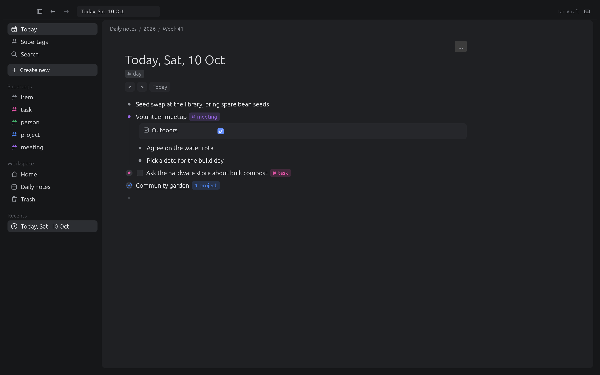
  <br><sub><b>Today.</b> Daily notes grouped by year and week, supertag chips, field rows, references and an Open tasks card.</sub>
</p>

## Tour

<table>
<tr>
<td width="50%" valign="top">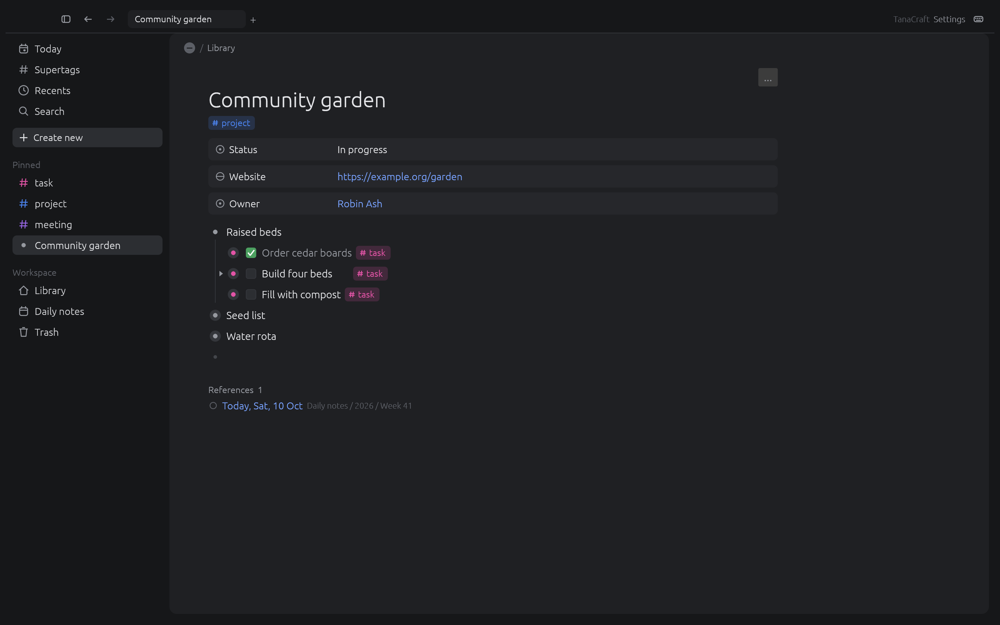<p align="center"><sub><b>Zoom into any node.</b> Fields from its supertags sit above its children; a field can hold several values.</sub></p></td>
<td width="50%" valign="top">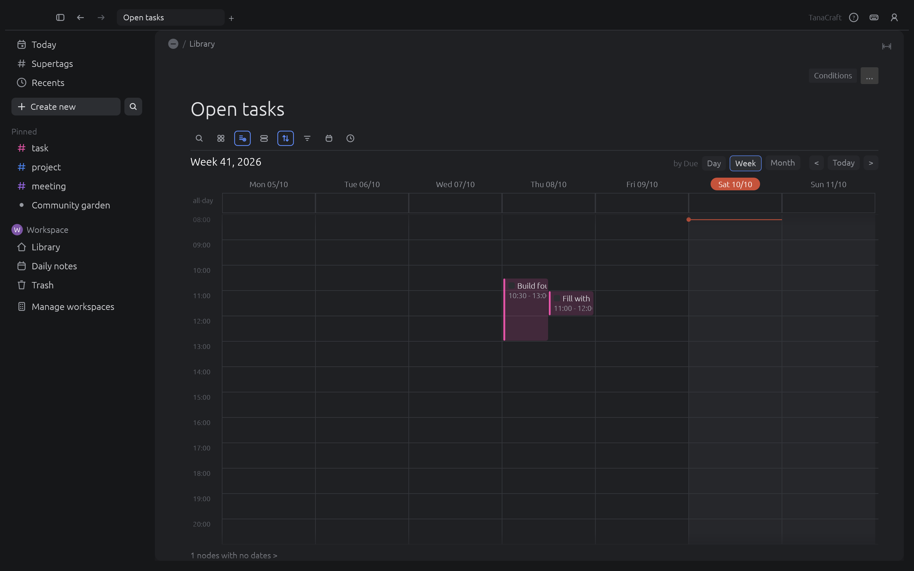<p align="center"><sub><b>Calendar.</b> Month, week and day. Drop an item on an hour to time it, drag its edge to resize, drag on empty grid to create.</sub></p></td>
</tr>
<tr>
<td width="50%" valign="top">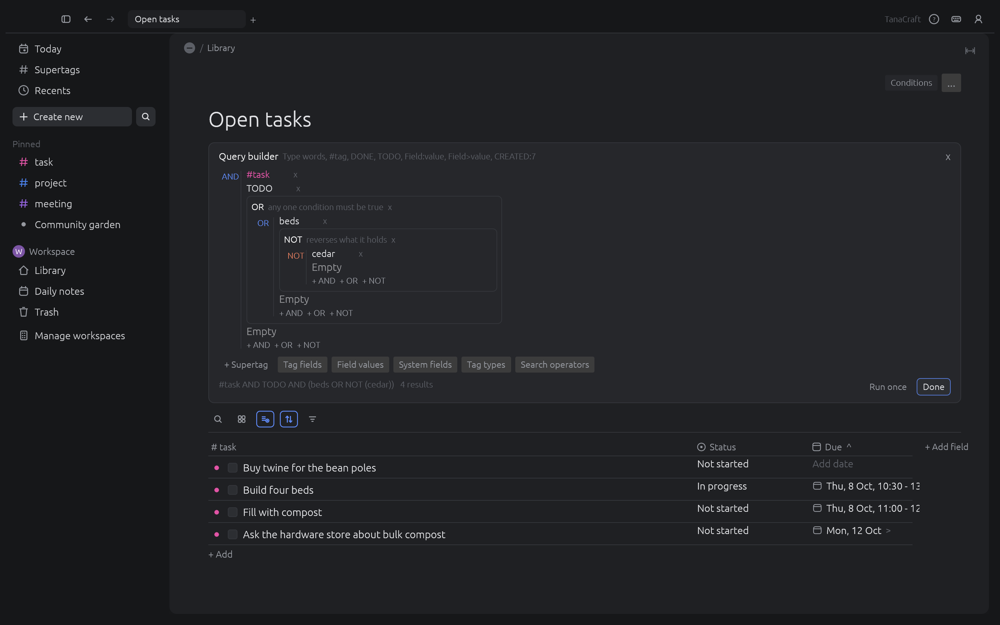<p align="center"><sub><b>Search nodes.</b> Live queries with nested AND, OR and NOT groups, shown as a table, cards, board, list or calendar.</sub></p></td>
<td width="50%" valign="top">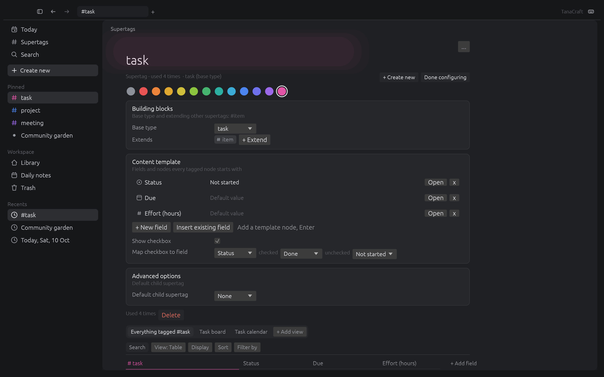<p align="center"><sub><b>Configure a supertag</b> in its own panel: template, optional fields, title expression, done mapping, default child supertag.</sub></p></td>
</tr>
<tr>
<td width="50%" valign="top">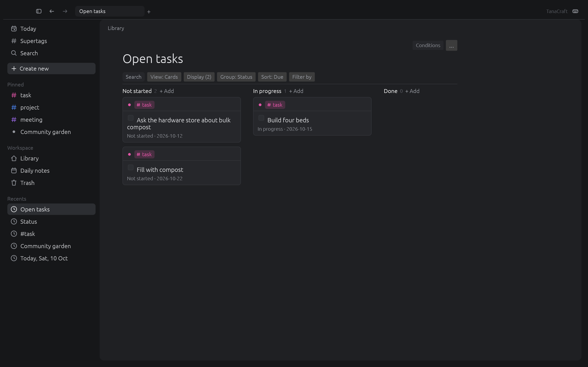<p align="center"><sub><b>Board.</b> Cards grouped by a field; drag a card to change its value.</sub></p></td>
<td width="50%" valign="top">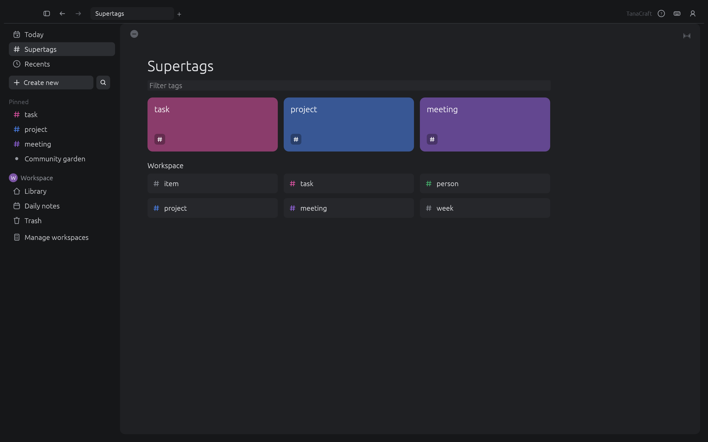<p align="center"><sub><b>Supertags.</b> Pinned ones as cards, then every supertag of the workspace.</sub></p></td>
</tr>
<tr>
<td width="50%" valign="top">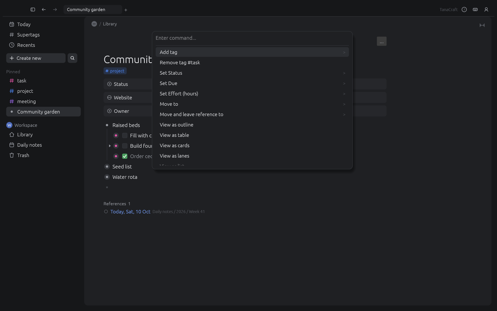<p align="center"><sub><b>Command line (Cmd+K).</b> Steps for the focused node first, then every command with its shortcut.</sub></p></td>
<td width="50%" valign="top">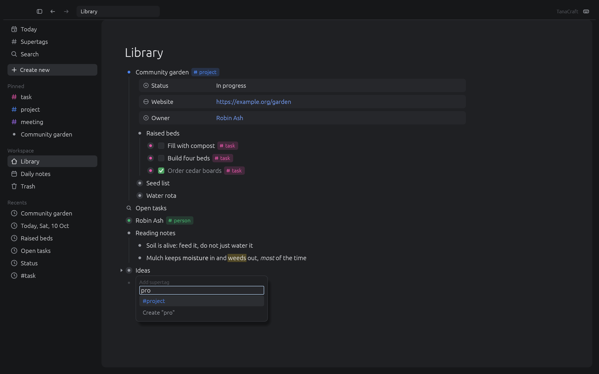<p align="center"><sub><b>Type <code>#</code>, <code>@</code>, <code>&gt;</code> or <code>/</code></b> in a line for supertags, references, fields and the insert menu.</sub></p></td>
</tr>
<tr>
<td width="50%" valign="top">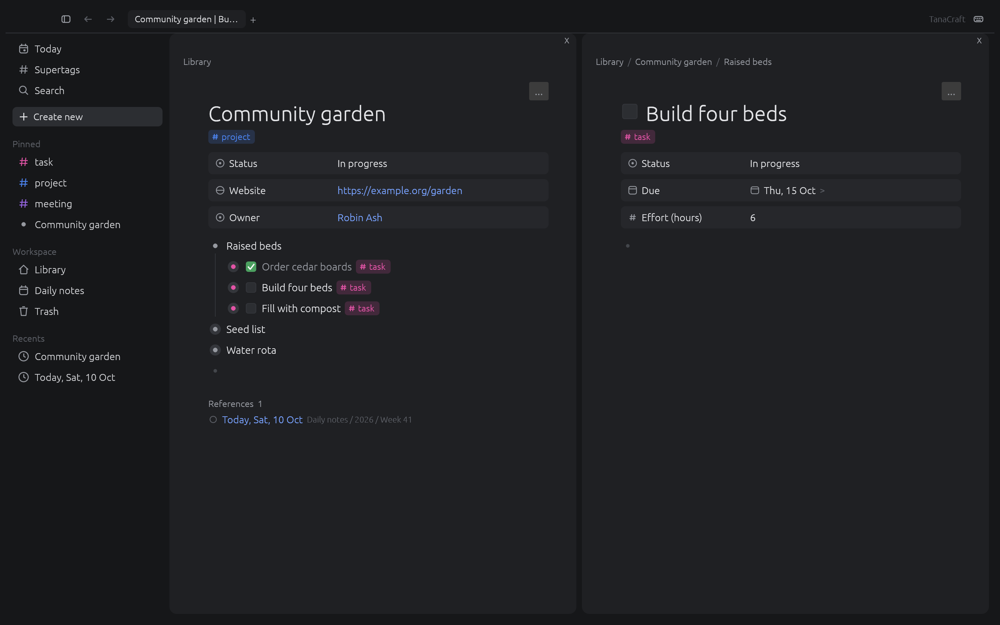<p align="center"><sub><b>Panels and tabs.</b> Cmd+M opens a node beside the current one; drag the gap to resize.</sub></p></td>
<td width="50%" valign="top">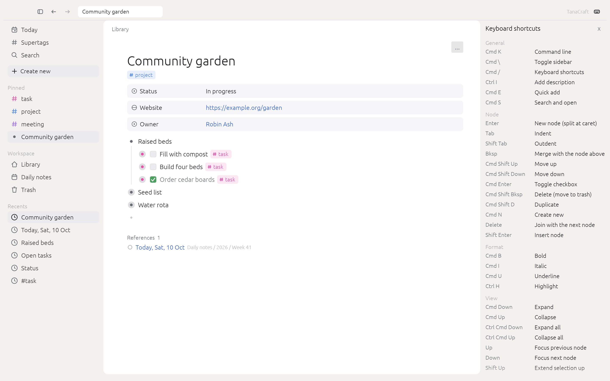<p align="center"><sub><b>Light theme</b> and the shortcut sheet (Shift+Cmd+?).</sub></p></td>
</tr>
</table>

Every screenshot is TanaCraft itself, rendered offscreen by `cargo xtask shots`.

## Why

Tana showed that an outliner gets much more useful when nodes can carry types: tag a bullet `#task`
and it gains a status, a due date and a checkbox; ask a search node for every open task and it stays
live. TanaCraft rebuilds that model as open source:

- **Local and yours.** One JSON file per workspace on your disk, saved atomically. No account, no server.
- **Fast and small.** Pure Rust with an immediate-mode UI; it starts in a blink and never blocks on the network.
- **Scriptable to the core.** Every action is a command with an id. The keyboard, the command line, the CLI, the MCP server and a JSON control channel all run the same commands, so an agent can do anything you can.
- **Clean room.** Built from public docs and a black-box behaviour spec; see [Clean room](#clean-room).

## What works today

| Area | Highlights |
|---|---|
| **Outline** | Enter, Shift+Enter, Tab, Shift+Tab, Backspace and Delete as in the spec, wrapped long lines, caret where you click, moves across branches, Escape and Shift+Up/Down selection with a floating toolbar, drag and drop, paste as nodes or references, headings, descriptions edited in place, inline bold/italic/underline/highlight/code that carry on as you type, links, checklists with progress |
| **Supertags** | Inline `#` menu, colours (or none, or custom), extends, base types, template fields and nodes, optional and pinned fields, title expressions, checkbox and done mapping, default child supertag, related content, convert a node to a supertag |
| **Fields** | `>` field rows (Tab to the value, Enter for another value); plain, options, options from a supertag, date (with time ranges), number, URL, email, checkbox; several values per field, option sources and auto-collect, required, hide rules, invalid-value warnings, auto-initialize |
| **Search** | Search nodes with nested AND/OR/NOT groups, field comparisons and field values (parent, relative dates, set, defined), date, type, scope and workspace operators; new results flash; Search and open with fuzzy matching and snippets; a context-aware command line |
| **Views** | Outline, table (full width, rename columns in place, resize), cards, board, lanes (drag between lanes), list (detail in the next panel), side menu, tabs, calendar (month, week and day with a time grid); display, sort, group and filter from an icon toolbar |
| **Daily notes** | Year, week and day nodes, relative titles, Open tasks card, week Schedule, go to date, insert date, dates that link to their day |
| **Shell** | Tabs, resizable panels, sidebar full/mini/hidden with flyouts, pinned items, quick add, capture Inbox, several workspaces side by side (each with its own Library, Schema and Trash), page icons and banners, content width, Help page, settings with sub-pages (date and time, sidebar entries, URL embeds), a native macOS menu bar, trash |
| **Undo** | Every command is one undo step; typing a word is one step; a failed command changes nothing |
| **Files** | One JSON graph file (`~/TanaCraft/graph.json` by default) holding every workspace, atomic autosave, repair of damaged files, Markdown, JSON and OPML export, Markdown and OPML import, HTML plus text on the clipboard |

Status per spec section and screenshot: [docs/parity.md](docs/parity.md) (77 of 95 spec sections
done, 13 partial; 140 of 160 screenshots done). AI features are out of scope for now.

## Speed and robustness

Measured on a generated 50,000-node workspace (`sample::large`), release build, Apple Silicon laptop:

| Action | Time |
|---|---|
| Typing one character (engine) | 0.001 ms |
| Enter, expand or collapse, undo (engine) | under 0.01 ms |
| Whole UI frame with all 51,550 rows expanded (typing, idle, expand key) | about 6 ms |
| First frame after opening that page and expanding everything | 8 ms |
| Substring search / fuzzy Search and open over every node | 15 ms / 27 ms |
| Save / load the graph file | 15 ms / 44 ms |

The outline draws only the rows near the viewport (the rest is blank space of their measured
height). A row holding an editor (a line being typed, a field value or name, a description) is
always laid out, on screen or not, and every editor scrolls itself into view when it takes the
keyboard, so typed text never depends on where a row sits. Reproduce: `cargo test -p tanacraft-commands --test perf --release -- --nocapture` and
`cargo test -p tanacraft-ui-egui --test perf --release -- --nocapture`.

A fuzz test runs random sequences of every command (params built from each command's own
description) and checks after each step that owners and children agree, nothing is orphaned or in a
loop, every change undoes and redoes exactly, and save/load round-trips; damaged files (loops, double
owners, dangling ids, links to nodes of the wrong kind) load into a sound graph and keep working under
random commands. A UI fuzz test types random keys and text and clicks random points in the real UI;
it must never panic, and while you type the keyboard must never go nowhere: after every key an editor
or a menu still has it, or a line is selected, and typed text always lands somewhere. It also runs
on a 70-line page in a small window, typing `>` field rows low on the page, and a quit test reloads
the file after a random run, every third time as a force-kill (only what autosave wrote counts). Bugs these found are fixed and stay covered (undo cutting out structure made
while navigating, template copies doubling an outline, a crash on a deep recursion, focus left on
widgets that were not drawn, field values typed below the first screen, editors left open on
another page, a line indented under a search node, keys lost after Shift+Tab out of a field, Cmd+K then Escape, Escape in
a page title, or egui's own arrow-key focus moving to a button). Longer runs:
`FUZZ_SEEDS=1000 FUZZ_STEPS=400 cargo test -p tanacraft-commands --test fuzz --release` and
`UI_FUZZ_SEEDS=500 cargo test -p tanacraft-ui-egui --test ui_fuzz --release`.

## Quick start

```sh
cargo run --release -p tanacraft -- --sample          # the desktop app with the sample graph
cargo run --release -p tanacraft -- notes.json        # open or create a graph file
```

Then press **Cmd+K** for every command, **Cmd+S** to search and open, **Cmd+E** for quick add and
**Shift+Cmd+?** for the shortcut sheet.

## For agents: CLI, MCP and the control channel

Every action is a command with an id (`node.indent`, `tag.add`, `field.addValue`, `search.addGroup`,
`nav.today` ...). The same commands drive the keyboard shortcuts, the command line, the CLI, the MCP
server and the control channel. `tanacraft-cli commands` lists all 174 with their parameters.

```sh
tanacraft-cli commands                                  # every command, shortcut and params
tanacraft-cli add "Plant garlic" --today --tag task     # prints the new node id
tanacraft-cli capture "Call the plumber"                # into the capture Inbox
tanacraft-cli import notes.md                           # a Markdown outline into the Library
tanacraft-cli run --cmd 'field.set={"node":46,"field":"Due","value":"2026-10-20 09:00-10:00"}'
tanacraft-cli export today                              # Markdown outline
tanacraft-cli export 2 --format json                    # JSON tree of the Library
tanacraft-mcp --file graph.json                         # MCP server on stdio (headless)
tanacraft --control 7991 &                              # app + JSON control channel
tanacraft-mcp --connect 127.0.0.1:7991                  # MCP driving the running app
```

## Architecture

| Crate | Job |
|---|---|
| `crates/core` | Node graph: nodes, supertags, fields, references, queries, views, daily notes, trash, undo/redo, JSON file, export |
| `crates/commands` | `Session` (graph, focus, panels' navigation) and the command registry (ids, labels, shortcuts, params) |
| `crates/mcp` | MCP server library and the `tanacraft-mcp` binary |
| `crates/ui-egui` | egui front end; tests drive it with real keys, clicks and drags; the offscreen `ui_shot` example |
| `apps/tanacraft` | Desktop app (eframe) with the control channel |
| `apps/tanacraft-cli` | Command line |
| `xtask` | `cargo xtask ci`, `cargo xtask shots`, `cargo xtask parity` |

Nothing below `ui-egui` depends on egui, and the UI only ever calls `Session::run`.

## Roadmap

Done: the core graph, commands, desktop app, agents (CLI, MCP, control channel), views, the editing
rules of the spec, supertag and field configuration, the calendar time grid, workspaces and the capture
Inbox, and every behaviour difference the spec team reported in its acceptance tests (rounds 3 to 7:
fields saved as typed, on quit and within a second for a force-kill, on rows below the first screen too, no typed key ever dropped, notes outlines on references and in
exports, formatted HTML on the clipboard, menu bar with keys and clipboard items). Next: an open-licence UI font with real bold and,
later, AI features. Details in [ROADMAP.md](ROADMAP.md).

## Clean room

TanaCraft is built from Tana's public documentation and a black-box behaviour spec written by a
separate team. Nobody on this side opens the Tana app, its files or any reverse-engineering tool. See
[AGENTS.md](AGENTS.md). Every asset is original; icons are drawn in code.

## License

MIT OR Apache-2.0. Not affiliated with Tana Inc.
