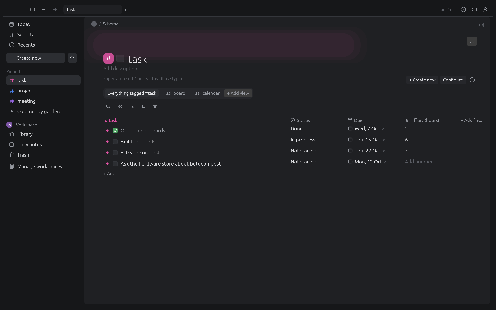

<h1 align="center">TanaCraft</h1>

<p align="center">
  <b>A keyboard-first outliner with supertags, fields and daily notes; an open-source, clean-room
  reimplementation of the Tana outliner, rebuilt in pure Rust.</b>
</p>

<p align="center">
  Every bullet is a node. Tag a node with a supertag and it gains that supertag's fields. Reference any
  node from anywhere. Write by hierarchy or by day. Your graph is one local JSON file, and every action
  is a command that people, scripts and AI agents can run.
</p>

<p align="center">
  
  <br><sub><b>Today.</b> Daily notes grouped by year and week, supertag chips, field rows and references.</sub>
</p>

<table>
<tr>
<td width="50%" valign="top"><p align="center"><sub><b>Zoom into any node.</b> Fields from its supertags sit above its children.</sub></p></td>
<td width="50%" valign="top"><p align="center"><sub><b>Supertags</b> extend each other, carry typed template fields and list everything tagged with them.</sub></p></td>
</tr>
<tr>
<td width="50%" valign="top"><p align="center"><sub><b>Command line</b> (Cmd+K): open nodes and run any command.</sub></p></td>
<td width="50%" valign="top"><p align="center"><sub><b>Light theme</b> and the shortcuts panel.</sub></p></td>
</tr>
</table>

Every screenshot is TanaCraft itself, rendered offscreen by `cargo xtask shots`.

## What works today

| Area | Highlights |
|---|---|
| **Outline** | Enter splits at the caret, Tab and Shift+Tab, Backspace merges, move up and down, expand and collapse (all), zoom in and out, breadcrumbs, back and forward, checkboxes, duplicate, descriptions |
| **Supertags** | `#` picker creates or applies a supertag; colours; inheritance (extends); checkbox supertags; supertag pages listing template fields and tagged nodes |
| **Fields** | `>` picker; plain, options (auto-collected), options from supertag, date, number, URL, email and checkbox fields, validated; default values |
| **References** | `@` picker turns a bullet into a reference; references show and edit their target in place |
| **Daily notes** | Day nodes under year and ISO week, previous and next day, Ctrl+Shift+D for today |
| **Trash** | Deleting moves to Trash, restorable to its old place; empty trash |
| **Undo** | Every command is one undo step; typing a word is one step; a failed command changes nothing |
| **Files** | One JSON file (`~/TanaCraft/graph.json` by default), atomic autosave, Markdown and JSON export |

Status per spec item: [docs/parity.md](docs/parity.md). Plans: [ROADMAP.md](ROADMAP.md).

## Quick start

```sh
cargo run --release -p tanacraft -- --sample          # the desktop app with the sample graph
cargo run --release -p tanacraft -- notes.json        # open or create a graph file
```

## For agents: CLI, MCP and the control channel

Every action is a command with an id (`node.indent`, `tag.add`, `field.set`, `nav.today` ...). The same
commands drive the keyboard shortcuts, the command line, the CLI, the MCP server and the control channel.

```sh
tanacraft-cli commands                                  # every command, shortcut and params
tanacraft-cli add "Plant garlic" --today --tag task     # prints the new node id
tanacraft-cli run --cmd 'field.set={"node":46,"field":"Due","value":"2026-10-20"}'
tanacraft-cli export today                              # Markdown outline
tanacraft-cli export 2 --format json                    # JSON tree of Home
tanacraft-mcp --file graph.json                         # MCP server on stdio (headless)
tanacraft --control 7991 &                              # app + JSON control channel
tanacraft-mcp --connect 127.0.0.1:7991                  # MCP driving the running app
```

## Architecture

| Crate | Job |
|---|---|
| `crates/core` | Node graph: nodes, supertags, fields, references, daily notes, trash, undo/redo, JSON file, export |
| `crates/commands` | `Session` and the command registry (ids, labels, shortcuts, params) |
| `crates/mcp` | MCP server library and the `tanacraft-mcp` binary |
| `crates/ui-egui` | egui front end and the offscreen `ui_shot` example |
| `apps/tanacraft` | Desktop app (eframe) with the control channel |
| `apps/tanacraft-cli` | Command line |
| `xtask` | `cargo xtask ci`, `cargo xtask shots`, `cargo xtask parity` |

## Clean room

TanaCraft is built from Tana's public documentation and a black-box behaviour spec written by a
separate team. Nobody on this side opens the Tana app, its files or any reverse-engineering tool. See
[AGENTS.md](AGENTS.md). Every asset is original; icons are drawn in code.

## License

MIT OR Apache-2.0. Not affiliated with Tana Inc.
