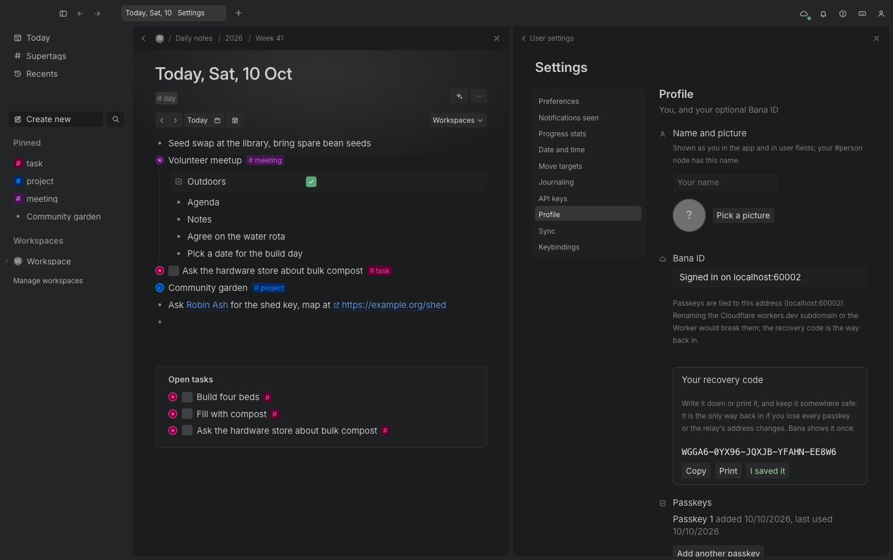

# Bana ID

Bana works fully without an account. Your notes live on your devices, and you never have to sign
up for anything.

A **Bana ID** is optional. It does two jobs only:

1. **A new device gets your notes.** Sign in on it with your passkey and your encrypted notes
   arrive through sync. No QR code to scan.
2. **You get back in if you lose a device.** A passkey (or your recovery code) is enough.

There are no passwords. You sign in with a **passkey**: your device makes one and keeps it (on
Apple devices in iCloud Keychain, so it is on your Mac and iPhone at once), and checks it is you
with Face ID, Touch ID or your device code.

<p></p>

## Where to find it

- **First launch** (desktop and iPhone): the welcome asks your name and picture, light or dark,
  how to start (fresh, the sample, or an import), and then, optionally, **Sync your devices**:
  Create Bana ID, Sign in, use a recovery code, or pair with a code. Every step can be skipped.
- **Desktop**: account menu (top right), **Profile and Bana ID** (also Settings, Profile).
- **iPhone**: Manage, then your name at the top.

The profile page has your name and picture (your #person node in the notes has the same name),
your Bana ID status, your passkeys (add another, remove one), your devices (rename, remove), the
recovery code (make a new one), **Sign out of this device** (your notes stay) and **Delete Bana
ID**.

## The domain (set once)

A passkey belongs to the exact web address (host) that made it. For Bana ID that is the relay's
host, set in `cloudflare/sync/wrangler.jsonc` as `RP_ID`:

```jsonc
"vars": { "RP_ID": "bana-sync.lifeos-read-mirror-worker.workers.dev" }
```

This is the free `workers.dev` address of the relay. The full host is used (not just
`workers.dev`, which is on the public suffix list), so no other Worker on the account can use
these passkeys.

**Passkeys are tied to this address.** Renaming the Cloudflare `workers.dev` subdomain, or
renaming the Worker, changes the address and breaks every passkey already made. Your notes are
safe (they are on your devices), and **the recovery code is the way back in**: sign in with it on
the new address and add a new passkey. The relay's wizard (`cloudflare/sync/wizard.sh`) sets
`RP_ID` from your subdomain when it deploys; someone running their own relay changes the app's
relay field to their address (the default is the one above).

## How signing in works

```
 Bana app ──opens──▶ sign-in page on the relay (its own address)
                       │ passkey: Face ID / Touch ID
                       ▼
           one-time code ──back to the app──▶ app swaps it once for a session
```

1. The app opens the sign-in page that the relay serves: in the system sign-in sheet on the
   iPhone, in your browser on the Mac. (A free Apple developer account cannot use the native
   passkey screens, so the page does it.)
2. The page uses your passkey. Your device also gives the page a secret only that passkey can
   make (the WebAuthn **PRF** extension). The page hides that secret so that only this app can
   read it, using a one-time key the app made for this sign-in.
3. The page sends you back to the app with a **one-time code** (on the iPhone through
   `bana://auth/...`, on the Mac to the app itself on `127.0.0.1`). The code works once, for two
   minutes. The app swaps it for a session for this device.
4. On a new device, the app uses the passkey's secret to unlock your workspace key and joins
   sync. Your notes arrive.

## What Cloudflare (or whoever runs the relay) can and cannot see

It **cannot** see:

- your notes, their names or anything in them (sync is end-to-end encrypted, see
  [sync.md](sync.md));
- your **workspace key**: the relay keeps it only *wrapped* (locked) twice: once with a key that
  only your passkey can make, once with a key made from your recovery code. Neither unlocking key
  ever reaches the relay;
- your **recovery code**: the relay keeps only a one-way fingerprint of a value made from it,
  which tells it nothing about the key the code unlocks;
- your devices' names: they are encrypted with the workspace key.

It **can** see:

- that a Bana ID exists, when it was made, and which passkeys belong to it (their public keys:
  these are meant to be public);
- how many devices are signed in, when each was last seen, and from which IP address;
- the encrypted, wrapped keys and the sync data (which it cannot read).

One honest limit: the sign-in page runs on the relay's own address. Someone who could change the
relay's code (you, or anyone with your Cloudflare account) could change that page to keep the
passkey's secret. Keep your Cloudflare account safe, as you would any account that holds your
sync.

## If you lose your passkey

- **Lost one device**: your passkey is still on your other devices (iCloud Keychain). Remove the
  lost device on the profile page: it is signed out and shut out of sync.
- **Lost every passkey**, or the relay's address changed: on any device, choose **Use a recovery
  code**, type it in, and you are back. Then add a new passkey on the profile page.
- **Lost the passkeys and the recovery code**: the relay cannot help (it never had your key).
  Your notes are still on any device that has them; set up sync again from there and make a new
  Bana ID.

## The recovery code

- 25 letters and digits, shown as five groups (`XXXXX-XXXXX-XXXXX-XXXXX-XXXXX`). Case, spaces and
  dashes do not matter when you type it back.
- Shown **once**, when you create your Bana ID. Write it down or print it and keep it somewhere
  safe. Anyone with it (and the relay's address) can get your notes.
- Lost it but still signed in somewhere? Profile, **Make a new recovery code**: the old one stops
  working at once.

## When a passkey cannot unlock notes (no PRF)

Some browsers and platforms cannot give the passkey's secret (no PRF). Then the passkey still
signs you in, but it cannot unlock your notes on a new device. Bana says so on the page and on the
profile page ("cannot unlock notes: no PRF"). Use the recovery code, or **pair with a code** from a
device that already syncs (Settings, Sync, Add a device): QR pairing always works.

## Signing out and deleting

- **Sign out of this device**: the device's session ends and it stops syncing. The notes stay on
  it.
- **Remove a device** (from another one): the same for that device, and the relay shuts it out of
  the sync room.
- **Delete Bana ID**: removes the account, its passkeys, its sessions, the wrapped keys and the
  whole encrypted sync room from the relay. Notes on your devices stay; they stop syncing.
  Passkeys stay in your keychain until you delete them there (Passwords app on Apple devices).

## Limits (free plan)

One Durable Object (SQLite) holds every Bana ID on the relay. Per relay: 100 Bana IDs, 10 passkeys
and 20 devices per Bana ID. Per IP address: 30 sign-in steps then 20 a minute, 5 new Bana IDs then
one every 5 minutes, 5 recovery code tries then one every 10 minutes.

## For developers

| Piece | Where |
|---|---|
| Wrapping with PRF and recovery-code keys, the X25519 hand-back | `crates/sync/src/id.rs` |
| The app's side: `id.*` requests, the loopback listener, exchange, unwrap, join | `crates/sync/src/account.rs` |
| The relay's side: WebAuthn checks, accounts, codes, sessions, limits | `cloudflare/sync/src/id.ts`, `webauthn.ts`, the page in `page.ts`, `ID_LIMITS` in `limits.ts` |
| Profile (name, picture, onboarded) and the #person node | `crates/server/src/profile.rs`, `person.setMe` |
| Desktop UI | `web/src/Profile.tsx` (onboarding, Settings, Profile) |
| iPhone UI | `apps/bana-ios/Bana/Profile.swift` (onboarding, Manage, Profile, the sign-in sheet) |

Engine requests: `id.status`, `id.begin {mode: create|signin|add, relay?, ret: loopback|bana,
name?, person?, open?}` (answers the page's address), `id.finish {url}` (the callback address),
`id.cancel`, `id.recover {relay?, code}`, `id.account`, `id.renameDevice {sid, name}`,
`id.removeDevice {sid}`, `id.removePasskey {id}`, `id.newRecoveryCode`, `id.recoveryShown`,
`id.signOut`, `id.delete {confirm: true}`; `profile.get`, `profile.set {name?, avatar?,
onboarded?}`, `onboarding.sample`.

Relay API (`/id/api/`): `options`, `finish`, `exchange`, `recover` (rate limited per IP), and with
`Authorization: Bearer <session>`: `GET account`, `PUT vault {room?, wrap?, recovery?}`, `POST
ticket` (for adding a passkey), `DELETE credentials/<id>`, `PATCH devices/<sid> {name?, device?}`,
`DELETE devices/<sid>`, `DELETE account`. The page is `GET /id`.

Tests:

```sh
cargo test -p bana-sync id::                       # wrap and unwrap, wrong keys, tampering
cd cloudflare/sync && npm test                      # a software authenticator with PRF in workerd
pnpm --dir web exec playwright test --project=sync bana-id   # CDP virtual authenticator, desktop A and B
pnpm --dir web exec playwright test onboarding      # onboarding and the profile page
scripts/ios-test.sh                                 # onboarding and profile on the iPhone
scripts/ios-test.sh id                              # iPhone sign-in (see below)
```

The iPhone simulator cannot make passkeys in a UI test, so `scripts/ios-test.sh id` puts
`scripts/id-helper.mjs` in place of the sign-in sheet: it runs the page's steps with the same
software authenticator against the real relay and hands back the callback address. Everything
after the sheet (the code exchange, unmasking, unwrapping, joining sync) is the app's real code.
